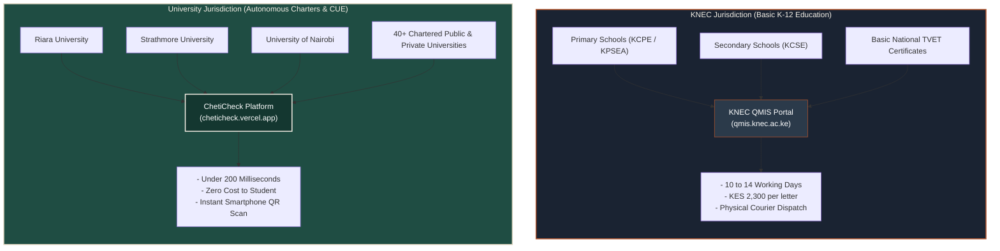
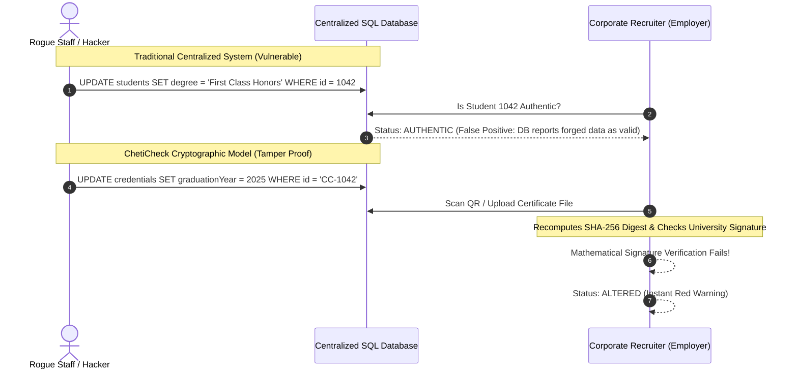
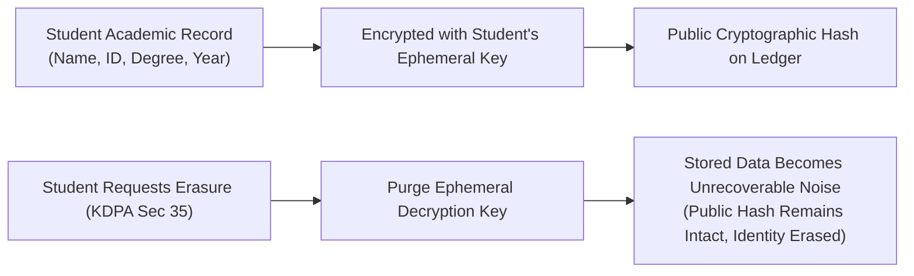

# ChetiCheck: Verifiable Academic Credentials Knowledge Base

**Audience**: Hackathon judges, university registrars, enterprise recruiters, student founders, and technical evaluators.  
**Purpose**: An accessible, authoritative guide to the cryptographic, legal, and operational reality behind **ChetiCheck**.  
**Repository Wiki**: [GitHub Wiki Page](wiki)

---

## Navigation & Core Topics

```text
├── 1. The Government Monopoly Myth (KNEC vs University Charters)
├── 2. Centralized Database Honeypots vs Asymmetric Ed25519 Signatures
├── 3. Why Not Blockchain? (The Gas Fee & Privacy Trap)
├── 4. Instant Offline Verification & Merkle Root Anchoring
├── 5. Institutional Realities & Commercial Model (PPADA 2015 & KES 250 API)
└── 6. Legal Compliance & Cryptographic Shredding (KDPA 2019 Right to Erasure)
```

---

## 1. The Government Monopoly Myth (KNEC vs University Charters)

A frequent objection raised during hackathon judging is:  
*"The Kenyan Government already runs KNEC and a national exam database. Why would universities or employers use ChetiCheck?"*

This objection confuses two fundamentally distinct regulatory jurisdictions in Kenya:



### The Legal Reality:
- **KNEC has zero jurisdiction, zero database records, and zero mandate over university degrees or postgraduate diplomas.**
- Under the **Universities Act (No. 42 of 2012)**, chartered universities in Kenya are autonomous degree-granting bodies regulated by the **Commission for University Education (CUE)**, not KNEC.
- If an employer approaches KNEC to verify a Bachelor of Science from Riara University, KNEC cannot verify it. The employer must physically send someone to the university registry or wait weeks for registry letters.
- **ChetiCheck closes the multi-billion-shilling credential fraud market in higher education that KNEC is legally and operationally incapable of addressing.**

### Comparison Table: KNEC QMIS vs ChetiCheck

| Feature | KNEC QMIS Portal (`qmis.knec.ac.ke`) | ChetiCheck Platform |
| :--- | :--- | :--- |
| **Target Sector** | Primary & Secondary (KCPE / KCSE) | **Higher Education Degrees, Diplomas, & Certificates** |
| **Verification Speed** | **10 to 14 working days** | **Under 200 milliseconds** (instant) |
| **Cost to Verify** | **KES 2,280 – KES 2,320** per letter | **Free for graduate**, KES 250 for enterprise HR API |
| **Verification Method** | Manual staff search in physical/digital archives | Instant mathematical check against public key |
| **Delivery Mechanism** | Physical stamped paper letter via courier | Real-time digital stamp on any smartphone camera |
| **Tamper Resistance** | Paper letter can still be photoshopped | Cryptographic Ed25519 signature breaks if 1 byte changes |

---

## 2. Centralized Database Honeypots vs Asymmetric Ed25519 Signatures

Why does ChetiCheck use **asymmetric Ed25519 digital signatures** instead of just hosting a normal database like traditional university systems?



### The Plain-English Mental Model:
- **The Centralized Database Vulnerability**: Trust is placed in whoever currently has access to the database credentials. If a rogue administrator takes a bribe or an SQL injection exploit occurs, the database happily tells employers that a forged degree is valid.
- **The ChetiCheck Cryptographic Solution**: Trust is placed in mathematical law. When the degree is issued, the university registrar seals it with the university's private signing key. Even if a bad actor alters the database or photoshops a PDF, the mathematical signature does not match the altered data. The verification screen immediately flashes **Altered**.

---

## 3. Why Not Blockchain? (The Gas Fee & Privacy Trap)

Judges often ask: *"Why didn't you build this on Ethereum, Polygon, or Hyperledger?"*

1. **Transaction Fees (Gas Costs)**: Issuing 5,000 university degrees every graduation season on a public blockchain costs thousands of dollars in gas fees. ChetiCheck issuance cost is **zero**.
2. **Permanent Data Exposure (KDPA Violation)**: Public blockchain records are immutable forever. If a student's graduation data is permanently etched onto a public ledger, it violates the **Right to Erasure** under Section 35 of the Kenya Data Protection Act 2019.
3. **Throughput & Speed**: Blockchain confirmations take seconds to minutes. ChetiCheck asymmetric cryptographic verification takes **less than 2 milliseconds** client-side.

---

## 4. Instant Offline Verification & Merkle Anchoring

ChetiCheck certificates can be verified **100% offline**:
- The QR code contains the full signed JSON credential payload (or canonical SHA-256 digest + Ed25519 signature).
- A verifier's smartphone holds the university's public verification key.
- The browser calculates `SHA-256(payload)` and runs `Ed25519.verify(digest, signature, publicKey)`.
- If connectivity is unavailable, verification succeeds purely mathematically on the device without contacting the cloud.

---

## 5. Institutional Realities & Commercial Model

### The 18-Month Procurement Obstacle:
Kenyan chartered universities are bound by strict procurement protocols (under the Public Procurement and Asset Disposal Act - PPADA 2015). Selling an enterprise-wide infrastructure overhaul takes 12 to 18 months of tender notices, ICT committee vetting, Senate approvals, and budget allocations.

### ChetiCheck Commercial Strategy:
- **Zero Cost to Universities**: Universities issue certificates using our lightweight registrar portal with zero infrastructure upgrade costs.
- **Monetizing Enterprise Verifiers**:
  - Graduate verification via mobile camera is free forever.
  - Large corporate employers, banks, and recruitment agencies (e.g. BrighterMonday, Shortlist, corporate banks) pay **KES 250 per instant bulk API verification** to replace 3-week manual registry clearance processes.

---

## 6. Legal Compliance & Cryptographic Shredding (KDPA 2019)

Under Section 35 of the **Kenya Data Protection Act 2019 (KDPA)**, individuals have a statutory **Right to Erasure** ("Right to be Forgotten"). How can ChetiCheck comply if cryptographic records are tamper-proof?



### The Plain-English Mental Model:
Imagine a lockbox where a graduate's name is inside, but only the graduate holds the key. If the graduate asks to be forgotten, you destroy the key. The lockbox is now permanently unreadable junk numbers, effectively erasing the identity forever without destroying the structural validity of the university registry. This is known as **Cryptographic Shredding**, fully compliant with Office of the Data Protection Commissioner (ODPC) guidelines.
