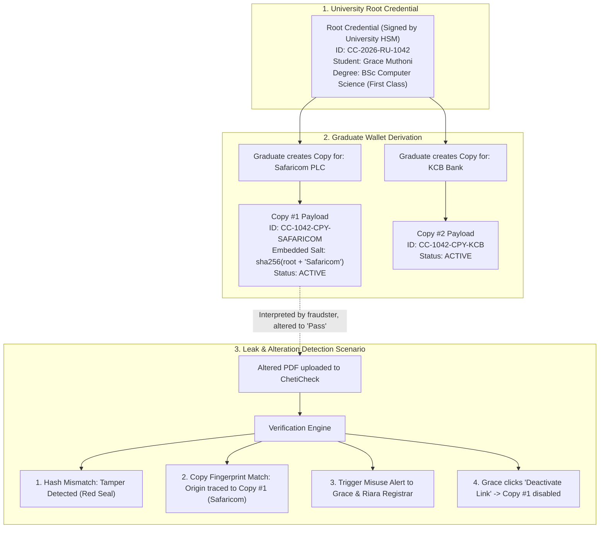

# Strategic Pivot Evaluation & Codebase Gap Analysis

**Subject**: Ivar's Traceable Application Copies & Misuse Investigation Model  
**Analysis Date**: 2026-10-23  
**Status**: Pre-Plan Architecture Assessment

---

## Executive Summary

Ivar's proposal represents a **paradigm shift** for ChetiCheck:
- **Traditional Competitor Model (KNEC / Basic Verifiers)**: Passive, point-in-time check. *"Is this certificate real? No."* -> Process terminates with no forensic value.
- **ChetiCheck Pivot Model**: Active Forensic Rights Management. *"This certificate is altered. It was derived from Grace's application to Safaricom PLC on 12 March 2026. The graduate and Riara University have been alerted, and that copy's QR link can now be deactivated."*

This directly eliminates the primary criticism judges level at verification platforms: **"Verification only stops honest people; fraudsters just alter PDFs and pass them to gullible HR teams."** By introducing **source-traceable watermarking**, ChetiCheck becomes an investigative tool that tracks credential leak vectors.

---

## Feature-by-Feature Codebase Gap Analysis

| Feature in Ivar's Spec | Current ChetiCheck Codebase Status | Architectural Gap & Required Additions | Complexity |
| :--- | :--- | :--- | :--- |
| **Graduate Certificate Wallet** | **Partially Built (60%)** Found in `/verify`, `/issuer`, and state stores. | Needs a dedicated student/graduate view `/wallet` where a student views their root degree and manages generated copies. | Low |
| **Certificate Upload as PDF or Photo** | **Built (90%)** Dual-mode JSON & file upload exists in `/verify`. | Currently parses `.cheti.json` and QR images. Need OCR or lightweight form-field extractor for photo/PDF rendering. | Medium |
| **Application-Specific Copies** | **New (0%)** | Need a copy generation engine: graduate inputs recipient (e.g. "Safaricom PLC") -> system creates a derived child record. | Low |
| **Unique Copy IDs & QR Codes** | **Partially Built (50%)** QR generator exists for root credentials. | Need deterministic child IDs (`CC-RU-1042-APP-01`) and distinct QR endpoints (`/verify?copy=...`). | Low |
| **Recipient & Application Labels** | **New (0%)** | Attach `recipient_name`, `purpose`, and `issued_at` metadata to each copy record. | Low |
| **Downloadable Certificate Copies** | **Built (80%)** Export `.cheti.json` exists. | Add visual labeled badge on certificate card (e.g. "Issued exclusively for Safaricom PLC"). | Low |
| **QR Code Scanning** | **Built (100%)** Camera QR scanner and file dropzone live. | Already functional via `html5-qrcode` / browser camera. | None |
| **Comparison with Issuer Records** | **Built (100%)** Cryptographic diff engine live. | Live SHA-256 canonical diff already checks name, grade, degree, year against database and public key. | None |
| **Highlighted Mismatches** | **Built (100%)** VerdictStamp shows exact diff reasons. | Already flags hash mismatches, altered grades, and revocation details. | None |
| **Reused-Copy Identification** | **New (0%)** | When an altered payload is verified, if the signature/hash matches a known copy salt, identify the leaked copy label. | Medium |
| **Private Misuse Alerts** | **New (0%)** | Add an event hook on verification failure: log incident to `MisuseIncident` table and display alert banner in Graduate Wallet & Registrar Portal. | Low |
| **Shared-Link Deactivation** | **Partially Built (70%)** Root revocation registry exists. | Extend revocation from root credential to individual `copy_id`. Deactivating a copy leaves the root degree 100% valid! | Low |
| **Verification Request Tracking** | **Partially Built (50%)** Telemetry events logged. | Need an analytics table recording: `timestamp`, `verifier_ip/agent`, `copy_id`, `result`. | Low |
| **Institution Investigation Dashboard** | **Partially Built (40%)** Registrar `/issuer` portal exists. | Add a new "Investigations & Flagged Copies" tab on `/issuer` showing audit trails of tampered certificates. | Medium |
| **Downloadable Verification Reports** | **New (0%)** | 1-click printable/PDF incident summary report for HR/police evidence. | Low |

---

## Architectural Gauging: How It Works Mechanically

### The Cryptographic Parent-Child Derivative Token Scheme

How do we create application-specific copies without re-signing the entire degree from the university HSM?

---

## Strategic Value & Hackathon Defensibility

1. **Addresses the Ultimate Judge Objection**:
   - Judge: *"Anyone can copy a PDF and submit it to a small company that doesn't check ChetiCheck."*
   - Defense: *"With ChetiCheck traceable copies, universities and graduates watermarking their applications know exactly where a leak occurred when an altered document resurfaces."*
2. **True Enterprise Selling Point**:
   - Large employers (Safaricom, Equity Bank, Government ministries) want to know if candidates are recycling or forging credentials between firms.
3. **High Build-to-Value Ratio**:
   - **80% of the cryptographic and verification foundation is already built** in ChetiCheck.
   - We are essentially adding **metadata tagging, child token routing, and an alert/deactivation status flag**.

---

## Next Steps

1. Review this evaluation.
2. Draft the formal technical implementation plan covering:
   - Data model schema updates (`Copy`, `MisuseAlert`, `AuditTrail`).
   - Graduate Wallet UI (`/wallet` tab).
   - Traceable Copy Generator modal.
   - Investigation Dashboard tab on `/issuer`.
